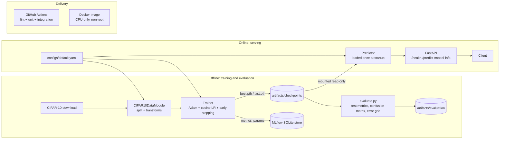

# VisionForge: Architecture and Engineering Report

This document describes how VisionForge was built, phase by phase, from data engineering to CI/CD. It covers the design decisions, the trade-offs behind them, the measured results, and the known limitations. For setup and usage, see [README.md](README.md).

## Contents

1. [Goals and scope](#1-goals-and-scope)
2. [System overview](#2-system-overview)
3. [Repository layout](#3-repository-layout)
4. [Configuration as the single source of truth](#4-configuration-as-the-single-source-of-truth)
5. [Phase 1: Dataset engineering](#5-phase-1-dataset-engineering)
6. [Phase 2: Model architecture](#6-phase-2-model-architecture)
7. [Phase 3: Training pipeline](#7-phase-3-training-pipeline)
8. [Phase 4: Checkpointing and experiment tracking](#8-phase-4-checkpointing-and-experiment-tracking)
9. [Phase 5: Evaluation and error analysis](#9-phase-5-evaluation-and-error-analysis)
10. [Phase 6: Performance optimization](#10-phase-6-performance-optimization)
11. [Phase 7: Model serving](#11-phase-7-model-serving)
12. [Phase 8: Dockerization](#12-phase-8-dockerization)
13. [Phase 9: Testing and CI/CD](#13-phase-9-testing-and-cicd)
14. [Results and benchmarks](#14-results-and-benchmarks)
15. [Known limitations and future work](#15-known-limitations-and-future-work)

---

## 1. Goals and scope

VisionForge is an end-to-end image classification project built on CIFAR-10 (60,000 32×32 colour images in 10 classes). The dataset is deliberately small. The goal was to practise the full machine learning engineering lifecycle with production habits, not to chase a leaderboard:

- reproducible data handling
- a trainable, configurable model
- resumable training with tracked experiments
- honest evaluation
- measured performance tuning
- a validated, containerised inference API
- automated tests and CI

Every phase leaves behind code, a test, or a documented decision.

## 2. System overview



Two properties hold the design together:

1. **One YAML file configures everything.** Training, evaluation, and serving read `configs/default.yaml`. Preprocessing statistics live there too, so training and inference cannot drift apart.
2. **The checkpoint is the contract between training and serving.** Serving only needs the weights and the config. It never imports the trainer, the optimizer, or MLflow.

## 3. Repository layout

```
configs/default.yaml           Hyperparameters, preprocessing, MLflow, and serving settings
scripts/train.py               Training entry point (supports --resume)
scripts/evaluate.py            Test-set evaluation and artifact generation
src/visionforge/
  data/                        transforms.py, datasets.py (CIFAR10DataModule)
  models/                      cnn.py (the production model)
  training/                    trainer.py, optimizer.py, earlystopping.py
  evaluation/                  evaluator.py, error_analysis.py
  serving/                     app.py (FastAPI), predictor.py, schemas.py
  utils/                       checkpointing.py, tracking.py, logging.py
tests/                         pytest suite (data, model, training, evaluation, inference, API, checkpoints)
Dockerfile, docker-compose.yml, .dockerignore
requirements.txt               Full training stack (local, CUDA)
requirements-serve.txt         Minimal pinned runtime for the inference image
requirements-dev.txt           Serving runtime plus test and lint tooling (CI)
.github/workflows/ci.yml       Lint, unit tests, integration test
```

## 4. Configuration as the single source of truth

`configs/default.yaml` holds every knob:

| Section | Keys |
| --- | --- |
| Data | `root_dir`, `random_seed`, `train_size`, `batch_size`, `eval_batch_size`, `num_workers`, `persistent_workers`, `pin_memory` |
| Model | `num_classes`, `channels`, `hidden`, `dropout` |
| Optimization | `optimizer_name`, `lr`, `weight_decay`, `scheduler_name`, `scheduler_params`, `num_epochs`, `patience` |
| Tracking | `mlflow.tracking_uri`, `mlflow.experiment_name` |
| Preprocessing | `image_size`, per-channel `mean` and `std` |
| Serving | `checkpoint_path`, `device`, `top_k`, `max_upload_bytes`, `class_names` |

Early in the project, the normalization statistics were hardcoded in the transforms module. They were moved into the `preprocessing` section so that the Predictor and the DataModule build their transforms from the same values through one function, `build_transforms`. In the container, a handful of `serving` values can be overridden with `VISIONFORGE_*` environment variables.

## 5. Phase 1: Dataset engineering

**Source.** `torchvision.datasets.CIFAR10` downloads the data. The 50,000-image training set is split into train and validation sets. The 10,000-image official test set is never used for model selection.

**Deterministic split.** `CIFAR10DataModule.setup` shuffles indices with a seeded `torch.Generator` (`random_seed: 42`) and takes 45,000 images for training and 5,000 for validation. Fixing the seed means the same images are held out on every run. This matters because a resumed run would otherwise leak validation images into the training set.

**Two datasets over the same files.** The training split uses the training transform. The validation split uses the evaluation transform. Both are `Subset` views over two `CIFAR10` objects that point at the same disk files, so validation images are never augmented.

**Transforms.**

| Stage | Training | Evaluation and inference |
| --- | --- | --- |
| Augmentation | `RandomHorizontalFlip`, `RandomCrop(32, padding=4)` | none |
| Tensor conversion | `ToTensor` | `ToTensor` |
| Normalization | per-channel mean and std from YAML | same |

Augmentation is applied only to training data. It acts as a regulariser: the model sees a slightly different version of each image every epoch, which reduces overfitting on 45,000 samples.

**Loaders.** Training batches are shuffled and use `batch_size` (128). Validation and test loaders are not shuffled and use `eval_batch_size` (512), since no gradients are held during evaluation and a larger batch is faster. `num_workers`, `persistent_workers`, and `pin_memory` come from the config (see Phase 6).

## 6. Phase 2: Model architecture

The model is a compact VGG-style CNN (`models/cnn.py`) with about **0.81 million parameters** (814,826 learnable parameters, counting BatchNorm scale and shift).

```
Input 3 × 32 × 32
 ├─ Block 1: [Conv3×3(3→32)  → BN → ReLU] × 2 → MaxPool2   →  32 × 16 × 16
 ├─ Block 2: [Conv3×3(32→64) → BN → ReLU] × 2 → MaxPool2   →  64 × 8 × 8
 ├─ Block 3: [Conv3×3(64→128)→ BN → ReLU] × 2 → MaxPool2   → 128 × 4 × 4
 ├─ Flatten (2048)
 ├─ Linear(2048→256, no bias) → BN → ReLU → Dropout(0.3)
 └─ Linear(256→10)   → logits
```

Design choices:

- **Two convolutions per block** deepen the receptive field before each pooling step. It is the same idea as VGG, at a much smaller scale.
- **Bias-free layers before BatchNorm.** BatchNorm subtracts the mean and learns its own shift, so a preceding bias is redundant.
- **BatchNorm everywhere.** It stabilises the activation distribution, tolerates a higher learning rate, and has a mild regularising effect.
- **Dropout (0.3) only in the classifier head.** That is where the largest dense layer, and so most of the overfitting risk, sits.
- **Depth and width as configuration.** `channels`, `hidden`, and `dropout` are constructor arguments, and the flattened size is computed from `len(channels)`. Changing the YAML changes the network with no code edits.
- **Raw logits as output.** `CrossEntropyLoss` applies log-softmax internally, so no softmax belongs in the model. The softmax is applied only at inference time.

The first version of the model was a smaller network with 16/32/64 channels and one convolution per block. It was replaced when the capacity-increase step of the accuracy plan was completed (see Section 14).

## 7. Phase 3: Training pipeline

`training/trainer.py` owns the loop. `scripts/train.py` wires together the config, data, model, optimizer, scheduler, and tracker.

**Per-epoch flow.**

1. `model.train()`, then for each batch: zero gradients (`set_to_none=True`), move data to the device, run the forward pass, compute the loss, backpropagate, and step the optimizer and scheduler.
2. After each epoch, run validation under `@torch.inference_mode()` with `model.eval()` and compute loss and accuracy.
3. Log metrics to MLflow, write checkpoints, and consult early stopping.

**Optimization setup.**

| Component | Choice |
| --- | --- |
| Loss | `CrossEntropyLoss` |
| Optimizer | Adam, `lr=1e-3`, `weight_decay=1e-3` |
| Scheduler | `CosineAnnealingLR(T_max=50, eta_min=0)` (see Section 15) |
| Early stopping | patience 5 on validation loss |
| Selection criterion | lowest validation loss |

Optimizer and scheduler are created through factory functions (`create_optimizer`, `create_scheduler`) that read names from the config, so swapping SGD for Adam or cosine for step decay is a config edit.

**Training and inference behave differently, on purpose.** Training uses `model.train()` (dropout active, BatchNorm using batch statistics and updating running averages) and tracks gradients. Validation and serving use `model.eval()` (dropout off, BatchNorm using running statistics) under `inference_mode`, which skips autograd bookkeeping and so saves memory and time.

## 8. Phase 4: Checkpointing and experiment tracking

**Two checkpoints per run** in `artifacts/checkpoints/`:

- `last.pth` is written every epoch. It holds the model state, optimizer state, epoch, validation loss, best validation loss, and the MLflow run ID. It exists to resume interrupted training.
- `best.pth` is written only when validation loss improves. It is what evaluation and serving use.

**Resume.** `python -m scripts.train --resume` loads `last.pth`, restores the optimizer state onto the target device, continues from `epoch + 1`, restores `best_val_loss`, and re-attaches to the original MLflow run. Without restoring the best loss, a resumed run could overwrite a better `best.pth` with a worse one.

**MLflow tracking** (local SQLite store). Each run records:

- all hyperparameters
- per-epoch `train_loss`, `val_loss`, and `val_accuracy_pct`
- throughput metrics (`epoch_seconds`, `samples_per_sec`, `data_wait_seconds`, `compute_seconds`)
- system metrics (CPU, memory)
- a `stopped_early_epoch` tag when early stopping triggers
- final evaluation metrics and artifacts

Failed runs are closed with status `FAILED`, so the tracking store stays truthful.

## 9. Phase 5: Evaluation and error analysis

`scripts/evaluate.py` loads `best.pth`, runs the held-out test set once, and reports:

- accuracy, macro-averaged precision, recall, and F1
- a confusion matrix, saved to `artifacts/evaluation/confusion_matrix.png`
- an error grid, saved to `artifacts/evaluation/error_grid.png`, showing misclassified images with the most confident mistakes first. This surfaces systematic failures (for example cat/dog confusion) and possible label noise.
- `metrics.json` and MLflow logging of the same numbers

**A debugging story worth telling.** The first evaluation reported **54.22%** test accuracy against roughly 73% validation accuracy from the same run. The gap was a stale `best.pth` left over from an earlier, weaker training run, so the evaluation was scoring a different model than the one just trained. After retraining and re-evaluating, test accuracy was **74.16%**, in line with validation. A large gap between validation and test accuracy is a signal to check the pipeline before checking the model.

## 10. Phase 6: Performance optimization

Performance work was done by measuring first. The trainer records, per epoch, total time, samples per second, time blocked waiting on the DataLoader, and compute time. The split between waiting and computing shows whether a run is input-bound or compute-bound.

**Findings.**

| Change | Observation |
| --- | --- |
| CPU-only PyTorch, 0 workers | About 243 s per epoch, about 185 samples/s. Compute-bound. |
| CUDA build of PyTorch | About 139 s per epoch, but data wait rose to about 107 s of it. The GPU was now starved by the single-process loader. |
| DataLoader worker sweep (20 logical CPUs) | 2 workers gave about 6-7 s per epoch (about 6,000 samples/s). 4 workers was slower in two separate runs (about 22-27 s). More workers is not always better because worker start-up, inter-process transfer, and CPU contention add cost. |
| Batch size 256 with 4 workers | One run reached about 5.3 s per epoch (about 8,500 samples/s). Another configuration at the same batch size was much slower. The results were inconsistent, so the default stayed at 128. |
| `persistent_workers=True`, `pin_memory=True` | Workers are kept alive between epochs, and host-to-GPU copies use pinned memory. Adopted. |
| `inference_mode()` and `eval_batch_size=512` | Less overhead during validation, test, and serving. |

Final choice: **batch size 128, 2 workers, persistent workers, pinned memory.**

**Caveat.** These timings come from a single development machine with other processes running. Throughput varied between runs, with later MLflow records of the full training run showing 25-40 s per epoch. Treat them as evidence for the direction of each change, not as portable benchmarks.

## 11. Phase 7: Model serving

The service is a FastAPI app (`serving/app.py`) over a `Predictor` class (`serving/predictor.py`).

### Endpoints

| Method and path | Purpose | Success | Failure modes |
| --- | --- | --- | --- |
| `GET /health` | Liveness and readiness | `200 {"status": "ok"}` | `503` if the model failed to load |
| `GET /model-info` | Architecture, parameter count, device, checkpoint epoch and validation loss, class names, preprocessing values | `200` | `503` |
| `POST /predict` | Classify an uploaded image (`multipart/form-data`, field `file`) | `200` with prediction, top-k list, and latency in ms | `415`, `413`, `400`, `503`, `500` |

### Model lifecycle

1. **Startup.** A FastAPI `lifespan` hook reads the config, applies environment overrides, builds the `Predictor`, loads `best.pth`, and calls `model.eval()`. This happens once.
2. **Serving.** Every request reuses the in-memory model. Nothing is loaded per request.
3. **Failure containment.** If loading fails, the exception is logged and the app starts with no model. `/health` and `/predict` then return `503`, which lets an orchestrator see the problem without a crash loop.

### Request validation and error handling

Validation is layered so that bad input is rejected as cheaply as possible:

| Check | Status |
| --- | --- |
| Model not loaded | `503` |
| Content type does not start with `image/` | `415` |
| Body larger than `max_upload_bytes` (5 MB default) | `413`, with a bounded read so an oversized body is never fully buffered |
| Empty file | `400` |
| Bytes that cannot be decoded as an image (`InvalidImageError`) | `400` |
| Anything unexpected | `500` with a generic message. The traceback goes to the log, not to the client. |

### Inference path

Decode with Pillow, convert to RGB (this handles grayscale and RGBA), resize to 32×32, apply the evaluation transform, run the model under `inference_mode`, apply softmax, and take the top-k. Inference is offloaded with `run_in_threadpool`, so one slow prediction does not block the event loop. The response includes the predicted class, its confidence, the top-k list, and the model's own latency in milliseconds.

### Latency

The reported `latency_ms` times only the forward pass and softmax. End-to-end latency also includes the upload, decoding, and resizing. A 0.8 M-parameter CNN on a single 32×32 image takes a few milliseconds on CPU, so request overhead, not the model, dominates. Loading the model once at startup removes what would otherwise be the most expensive step.

## 12. Phase 8: Dockerization

**Multi-stage build.** A builder stage creates a virtual environment at `/app/v_venv` with `python -m venv` and installs dependencies with pip. A runtime stage copies only that environment, the config, and the source onto a clean `python:3.12-slim-bookworm` base.

**Image size.** The first build used the full dependency set and measured 2.54 GB. Three changes reduced it to **1.59 GB**:

- Dependencies were split. `requirements-serve.txt` has only the packages the API needs (torch, torchvision, FastAPI, Uvicorn, Pillow, PyYAML, and a few others). MLflow, matplotlib, and scikit-learn stay in the training and dev requirements.
- CPU-only PyTorch wheels come from the PyTorch CPU index, which avoids the multi-gigabyte CUDA libraries.
- The multi-stage layout leaves build caches out of the final image.

**Design decisions.**

- **Weights are not baked in.** `best.pth` is mounted read-only at runtime (`./artifacts:/app/artifacts:ro`), so retraining needs no rebuild and the image stays model-agnostic.
- **Non-root user** (uid 10001).
- **Health check** calls `/health` using only the standard library, so no `curl` is needed in the image. A 60-second start period covers model loading.
- **Environment configuration.** `VISIONFORGE_CHECKPOINT_PATH`, `VISIONFORGE_DEVICE`, `VISIONFORGE_TOP_K`, and `VISIONFORGE_MAX_UPLOAD_BYTES` override the YAML `serving` section.
- **`.dockerignore`** keeps data, artifacts, MLflow stores, virtual environments, and git metadata out of the build context.
- **Pinned dependencies** in `requirements-serve.txt` make builds reproducible.

## 13. Phase 9: Testing and CI/CD

### Test suite

The suite has **27 tests** using pytest. It runs without downloading CIFAR-10 and without a GPU.

| File | What it verifies |
| --- | --- |
| `test_data.py` | Train and validation splits are disjoint, the split is reproducible for a given seed, batch shapes and dtypes are right, and normalization math is correct. Uses an in-memory fake dataset. |
| `test_model.py` | Feature-map shapes at each stage (parametrised), logits shape, a clear error for wrongly sized input, deterministic eval-mode output, and gradients reaching every parameter. |
| `test_training.py` | An `integration`-marked smoke test: one epoch of `Trainer.train` on random tensors gives finite losses and writes `last.pth` and `best.pth`. |
| `test_evaluation.py` | `collect_predictions` shapes and probabilities with an oracle model, and `evaluate_predictions` metrics on a known case. |
| `test_checkpointing.py` | Save and load round trip, `is_best=False` writes only `last.pth`, and a malformed checkpoint raises. |
| `test_inference.py` | Grayscale and RGBA inputs, invalid bytes raise `InvalidImageError`, class mapping, and deterministic predictions. |
| `test_serving.py` | Health, model-info, and predict through FastAPI's `TestClient`. Covers `415`, `413`, `400` for empty and invalid files, and `503` for a missing checkpoint. |

Shared fixtures in `conftest.py` create a randomly initialised checkpoint in a temporary directory, so API and inference tests run against the real model code with no trained weights needed.

### Continuous integration

`.github/workflows/ci.yml` runs on every push to `main` and every pull request:

| Job | Steps |
| --- | --- |
| `lint` | Install a pinned ruff, then `ruff check src tests scripts` |
| `test` | Install `requirements-dev.txt` with the CPU PyTorch index (pip cache keyed on the requirements file), run `pytest -m "not integration"`, then `pytest -m integration` |

CI never runs full training. The only training-related test is a one-epoch smoke run on random data. The lint gate currently selects error-level rules only (see Section 15).

## 14. Results and benchmarks

### Final model quality

| Metric | Value |
| --- | --- |
| **Validation accuracy** (best epoch, 5,000 held-out training images) | **87.64%** |
| **Validation loss** (best epoch) | **0.3597** |
| **Test accuracy** (10,000 official test images) | **87.33%** |
| Test precision (macro) | 87.36% |
| Test recall (macro) | 87.33% |
| Test F1 (macro) | 87.32% |
| Parameters | about 0.81 M |
| Best checkpoint | Epoch 34 (early stopping triggered at epoch 39) |

Validation and test accuracy differ by 0.3 percentage points. A gap that small is evidence that the model selection did not overfit to the validation set.

### How accuracy improved

| Stage | Test accuracy | Change |
| --- | --- | --- |
| First evaluation (stale checkpoint, not representative) | 54.22% | Pipeline bug, see Section 9 |
| Baseline after retraining | 74.16% | Small CNN, no augmentation |
| Final model | 87.33% | Augmentation, longer training, cosine LR schedule, weight decay and dropout, a wider and deeper CNN, and training on the full 45k split |

### Training dynamics (final run)

- Validation accuracy rose from 57.5% at epoch 1 to 87.6% at epoch 34.
- Train loss at the best epoch was 0.331, against a validation loss of 0.360. The small gap indicates mild overfitting.
- Validation accuracy fluctuated by a few points between late epochs (83-87%). See Section 15 for the likely cause.

### Operational benchmarks

| Metric | Value |
| --- | --- |
| Inference image size | 1.59 GB (down from 2.54 GB) |
| Test suite | 27 tests, about 30 s for the unit subset |
| Training throughput (this machine, 2 workers) | about 1,100-1,800 samples/s sustained |

## 15. Known limitations and future work

Being specific about weaknesses is part of the engineering record.

1. **The learning-rate schedule stepped per batch (fixed in code, results pending a retrain).** `Trainer` used to call `scheduler.step()` after every batch while `T_max` is a count of epochs, so the cosine cycle completed in about 100 optimizer steps instead of 50 epochs. The learning rate oscillated, which probably explains the noisy late-epoch validation accuracy. The scheduler now steps once per epoch, and on `--resume` it is fast-forwarded to the resumed epoch. **The benchmark numbers in Section 14 were produced before this fix** and should be refreshed after retraining.
2. **Early-stopping patience** is hardcoded to 5 in `Trainer` and not read from the `patience` config key.
3. **Adam with `weight_decay`** applies L2 regularisation, not decoupled weight decay. `AdamW` is the usual choice.
4. **Lint scope.** The CI lint gate selects only error-level rules. Broader rules (import sorting, unused imports) currently report 27 violations that have not yet been cleaned up.
5. **Mixed precision** (`torch.autocast`) and `torch.compile` were not explored. They are the next throughput levers on GPU.
6. **Batch size 256 with 4 workers** produced one very fast run and one slow run. It needs repeated, controlled measurements before being adopted.
7. **Serving** has no authentication, rate limiting, batch endpoint, or metrics endpoint. A production deployment would add them, plus structured logging.
9. **CI** does not build the Docker image. Adding a build-and-smoke-test job would catch Dockerfile regressions.
