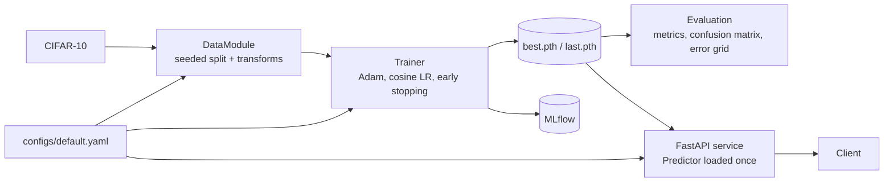

# VisionForge

An end-to-end image classification project in PyTorch. It goes from dataset engineering through training, evaluation, performance tuning, and a containerised FastAPI inference service to automated tests and CI. The task is CIFAR-10 (10 classes, 32×32 colour images). The aim was to build it the way a production ML system is built: reproducible, configurable, measured, tested, and deployable.

> For the full design write-up (every phase, trade-offs, benchmarks, and known limitations), read **[ARCHITECTURE.md](ARCHITECTURE.md)**.

## Results at a glance

| Metric | Value |
| --- | --- |
| Test accuracy (10,000 official test images) | **87.33%** |
| Test precision / recall / F1 (macro) | 87.36% / 87.33% / 87.32% |
| Validation accuracy (best epoch, 5,000 held-out images) | 87.64% |
| Validation loss (best epoch) | 0.3597 |
| Model size | about 0.81 M parameters |
| Inference image | 1.59 GB, CPU-only, non-root, with health check |
| Automated tests | 27 (pytest), with lint and tests in GitHub Actions |

Evaluation artifacts (confusion matrix, most-confident-errors grid, `metrics.json`) are written to `artifacts/evaluation/`.

## What this project demonstrates

| Phase | Highlights |
| --- | --- |
| 1. Data engineering | Seeded, reproducible 45k/5k train/validation split. Augmentation (random flip and crop) applied to training data only. Normalization values kept in config. |
| 2. Model | Configurable VGG-style CNN: 3 blocks of 2×(Conv-BatchNorm-ReLU), max-pooling, dropout head. |
| 3. Training | Modular trainer, Adam with cosine LR schedule, early stopping on validation loss, config-driven factories. |
| 4. Checkpointing and tracking | `best.pth` and `last.pth`, exact resume (model, optimizer, best loss, MLflow run), MLflow metrics and system stats. |
| 5. Evaluation | Held-out test metrics, confusion matrix, confident-error grid. Includes a diagnosed pipeline bug (a stale checkpoint caused a 20-point accuracy gap). |
| 6. Performance | Data-wait versus compute timing, a CUDA build, a DataLoader worker sweep, pinned memory, persistent workers, and `inference_mode`. |
| 7. Serving | FastAPI with `/health`, `/predict`, `/model-info`. Model loaded once. Layered input validation (415, 413, 400, 503, 500). Top-k and latency in the response. |
| 8. Docker | Multi-stage pip and venv build, CPU-only torch, split requirements (2.54 GB down to 1.59 GB), weights mounted at runtime, health check. |
| 9. Testing and CI/CD | 27 pytest tests (no downloads, no GPU), a smoke test instead of full training, and a GitHub Actions workflow for lint, unit, and integration tests. |

## Architecture



The model, training loop, and serving code all read `configs/default.yaml`, so preprocessing and model settings cannot drift between training and inference. See [ARCHITECTURE.md](ARCHITECTURE.md) for the layer-by-layer model description and design rationale.

## Quick start

Requires Python 3.12. Create an environment and install the training stack:

```powershell
python -m venv .venv
.\.venv\Scripts\Activate.ps1
pip install -r requirements.txt
```

Train, resume, and evaluate:

```powershell
python -m scripts.train
python -m scripts.train --resume
python -m scripts.evaluate
```

Training downloads CIFAR-10 to `data/` on the first run. Hyperparameters live in `configs/default.yaml`. View experiments with:

```powershell
mlflow ui --backend-store-uri sqlite:///mlflow.db
```

Run the API locally (needs `artifacts/checkpoints/best.pth`):

```powershell
uvicorn src.visionforge.serving.app:app --port 8000
```

### API

| Endpoint | Description |
| --- | --- |
| `GET /health` | Returns `{"status": "ok"}`, or 503 if the model is not loaded |
| `GET /model-info` | Architecture, parameter count, device, checkpoint epoch and validation loss, class names, preprocessing values |
| `POST /predict` | Upload an image (`multipart/form-data`, field `file`). Returns the predicted class, confidence, top-k predictions, and latency in ms |

Example response from `/predict`:

```json
{
  "prediction": {"class_index": 3, "label": "cat", "confidence": 0.91},
  "top_k": [
    {"class_index": 3, "label": "cat", "confidence": 0.91},
    {"class_index": 5, "label": "dog", "confidence": 0.06},
    {"class_index": 2, "label": "bird", "confidence": 0.01}
  ],
  "latency_ms": 4.2
}
```

The values above are illustrative. Error responses: `415` (not an image), `413` (upload too large), `400` (empty or undecodable image), `503` (model not loaded).

## Project layout

```
configs/default.yaml      All hyperparameters, preprocessing, tracking, and serving settings
scripts/                  train.py and evaluate.py entry points
src/visionforge/          data, models, training, evaluation, serving, utils
tests/                    pytest suite
Dockerfile, docker-compose.yml
requirements*.txt         Full (training), serve (runtime), and dev (CI) dependency sets
.github/workflows/ci.yml  CI pipeline
ARCHITECTURE.md           Detailed design and engineering report
```

## Known limitations

The main one is that the reported numbers were produced before a learning-rate scheduling fix (the cosine scheduler was stepped per batch but configured in epochs). The code is fixed and the model needs retraining to refresh the results. The full list is in [ARCHITECTURE.md](ARCHITECTURE.md#15-known-limitations-and-future-work).

## Docker: inference service

The image contains the code and locked dependencies only. Model weights are mounted at runtime from `./artifacts`, so retraining does not require a rebuild.

Prerequisites: Docker with Compose v2, and a trained checkpoint at `artifacts/checkpoints/best.pth`.

### Build

```powershell
docker compose build
```

Or without Compose:

```powershell
docker build -t visionforge-inference .
```

### Run

```powershell
docker compose up -d
docker compose ps        # STATUS should show "healthy" after ~30 s
```

Without Compose:

```powershell
docker run -d -p 8000:8000 -v "${PWD}/artifacts:/app/artifacts:ro" visionforge-inference
```

### Try it

```powershell
curl http://localhost:8000/health
curl http://localhost:8000/model-info
curl -F "file=@cat.png" http://localhost:8000/predict
```

Interactive docs are at http://localhost:8000/docs.

### Configuration

Environment variables override the `serving` section of `configs/default.yaml`:

| Variable | Default | Purpose |
| --- | --- | --- |
| `VISIONFORGE_CHECKPOINT_PATH` | `artifacts/checkpoints/best.pth` | Checkpoint path, relative to `/app` in the container |
| `VISIONFORGE_DEVICE` | `cpu` | Inference device |
| `VISIONFORGE_TOP_K` | `3` | Number of predictions returned |
| `VISIONFORGE_MAX_UPLOAD_BYTES` | `5242880` | Maximum upload size (5 MB) |
| `VISIONFORGE_HOST_PORT` | `8000` | Host port used by Compose |

Set them in the shell or in a `.env` file next to `docker-compose.yml`, for example:

```powershell
$env:VISIONFORGE_TOP_K = "5"; docker compose up -d
```

### Stop

```powershell
docker compose down
```

### Notes

- The container runs as a non-root user and uses the CPU build of PyTorch on Linux.
- Dependencies for the image come from `requirements-serve.txt`, installed with pip into `/app/v_venv`. The full training stack stays in `requirements.txt`.
- The image has a health check against `/health`.

## Testing and CI

Install the test and lint dependencies (CPU build of PyTorch):

```powershell
pip install --extra-index-url https://download.pytorch.org/whl/cpu -r requirements-dev.txt
```

Run the fast unit tests, then the integration tests:

```powershell
python -m pytest -m "not integration" -v
python -m pytest -m integration -v
ruff check src tests scripts
```

- Dataset tests replace `CIFAR10` with an in-memory fake, so nothing is downloaded.
- The `integration` marker covers the one-epoch training smoke test on random tensors. It is the only test that runs the trainer.
- CI never runs full training. The workflow in `.github/workflows/ci.yml` runs lint, unit tests, and the integration smoke test on every push to `main` and every pull request.
